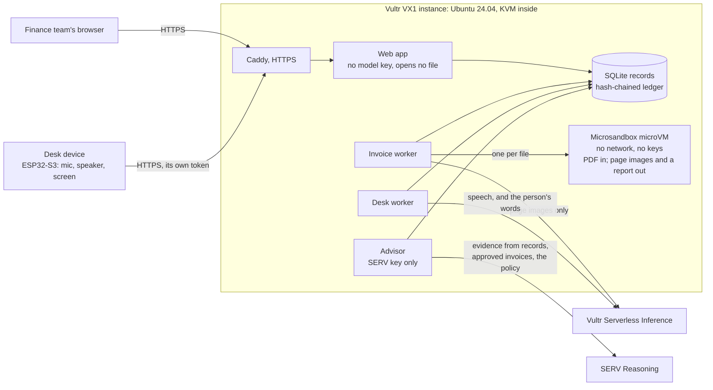

# Tally

An airlock for supplier invoices, for small finance teams.

Supplier invoices are files from strangers, and they now reach AI agents that can pay money. A PDF can carry
instructions a person never sees: white text, text under a shape, text off the page, a font too small to read. An
agent that reads the PDF's text layer reads those instructions too.

Tally opens every invoice in a throwaway sandbox with no network and no keys, and lets only two things out: the
pages as images, which are what a person would see, and a report of anything hidden or active in the file. The model
reads the images, never the text layer. Fixed rules, not the model, decide whether an invoice is held, and nothing is
paid until a person approves it.

Where code cannot judge, Tally asks [SERV Reasoning](https://docs.openserv.ai/serv-reasoning/why) and only takes
advice: a case file for each held invoice (is a new bank account an attempted fraud or a vendor that moved banks,
and which call to make first), and a plan for each payment run, read against the team's own policy in its own words.
Code checks every answer before anyone sees it, and a person decides.

## Judgement from SERV Reasoning, decisions from code

**Case files for held invoices.** The rules hold an invoice; they do not say what to do next. The advisor worker
gathers what Tally's records say about it (the checks that failed, the vendor's history and past bank changes,
other holds, the purchase order, earlier copies) and asks SERV Reasoning to weigh it: a summary, a risk, findings
that each cite the evidence they rest on, and next steps from a fixed list allowed for those holds. Code then keeps
only findings whose evidence exists and steps on the list, never lets a changed bank account be called "low" risk,
and writes the phone script itself, with the number on file. Approving, paying, releasing and changing bank details
are not on the list, so they cannot be proposed. The invoice page shows the case file under the checks, with the
evidence it was written from; the queue shows each held invoice's risk.

**Payment runs from a policy in plain words.** A person asks for a run: "Keep 5,000 back for payroll. Rent and
utilities are never late. Pay small suppliers before larger ones. Anything over 8,000 waits for month end unless it
is overdue", with the cash available and a pay date. SERV Reasoning reads that against the approved invoices,
decides which supplier is a utility or a landlord from its name on file, and proposes what to pay now and what to
leave, saying how it read each rule. It chooses among approved invoices only and gives no amount and no payee: code
fills both from the records, trims the plan to the cash, flags anything left overdue, and shows its own plan (due
soonest first) beside it. A person approves the exact plan by its hash; it is rebuilt from the records inside that
transaction, so a bank account changed in the meantime refuses the whole run. Tally then writes the payment file for
the bank from the bank details on file. It records payments; it does not move money.

| | Case file | Payment run |
|---|---|---|
| SERV model | `gpt-5.4-mini`, then `gemini-2.5-flash` | `gpt-5.4-mini`, then `gemini-2.5-flash` |
| SERV features | strict JSON schema, prompt guard, shadow agent (its hint: every finding cites given evidence, every step is allowed) | strict JSON schema |
| What the model sees | evidence built by code from records; of the invoice, only amounts, dates and an account's country and last four characters | the policy, the cash, the pay date, and the approved invoices by vendor name on file, amount and dates |
| What code checks | cited evidence exists; steps allowed for the holds; a risk floor per hold; the phone script | ids on the list; within the cash; amounts and payees from records; overdue flags; approval by hash, rebuilt from records |
| In the ledger | model, SERV request id, cost, what code dropped | the plan's hash, model, SERV request id, cost, one entry per payment |

Measured live, Nov 13 (`tests/test_cases.py`, `tests/test_payruns.py` and `lab/reppo.py` repeat these):

- Four held invoices, one case file each, $0.002 to $0.005 and 9 to 26 seconds each, nothing dropped by code: an
  unannounced switch to a German account on a vendor paid six times from a UK one, for 3.75 times its usual amount
  (high risk; phone the number on file first, then record the change only if confirmed, else reject as attempted
  fraud); a name one letter off a vendor on file (high; phone the real vendor); no purchase order on a regular water
  bill (low; ask whoever ordered it); a copy of an approved invoice (medium; reject as a duplicate).
- The first wording of the risk guidance called that German account "medium, likely a mismatch". Naming the signals
  of invoice fraud in the guidance made it "high". One answer from a model that varies proves little, so Reppo's
  panel of independent evaluators graded six held cases under each wording, each case in a workspace of its own
  (`lab/reppo.py`; synthetic records only, as Reppo's evaluations are public). The first wording averaged 95.2 of
  100, with the foreign-account case at 71 (completeness 56, factual accuracy 62); the wording in use scored 100 on
  all six, each routed "ship". A third wording, written after Reppo marked one case file down for a summary that
  disagreed with its own risk, graded no better (96.2): that low mark came from the lab itself, which had put every
  held invoice under one vendor, so each case saw the others' holds. It was not kept.
- One payment run, with the policy above, 13,500 of cash and seven approved invoices from five suppliers: SERV kept
  5,000 back, paid the overdue water bill, the rent and the small electrician first, and left the 9,600 hosting bill
  to month end, 7,036.70 in all, for $0.007 in 13 seconds. Code's due-date plan would have paid 9,346.70 and broken
  the payroll reserve. Reppo graded a plan for the same run 100, routed "ship".
- The whole graded comparison (18 case files and a plan) cost $0.08 of SERV and 7,920 of Reppo's credits.

The advisor holds the SERV key and nothing else; the web app has no model key. Each workspace caps SERV spending per
day ($1 by default, $0.50 for the public demo).

## How this was built

Tally was built from Nov 3 to Nov 8: the airlock, the two readers, the rules, the ledger, the web app, the lab, the
FATURA benchmark and the desk device, running on Vultr. From Nov 13 it was extended for OpenServ's SERV Hackathon,
Edition 02, which asks for entries built on SERV Reasoning. Everything in the section above, and nothing before it,
was built for that, in the open, in the commits from `e185f0d` on.

How we chose what to build, briefly:

1. **Where does Tally need judgement that code cannot give?** Not in reading (two models already check each other,
   and SERV documents no image input) and not in deciding (the rules must stay code). It needed judgement in two
   places a person works by hand today: working out what a hold means, and choosing what to pay when cash is short.
2. **The options.** (A) SERV plans payment runs, and an agent pays them through Kite Passport within spending
   limits; (B) SERV investigates each hold into a case file; (C) people's releases and rejections as feedback through
   Reppo to reduce false holds; (D) the desk board's button as a payment trigger.
3. **What research changed.** Payment preflights ("check, then pay, hold or block") were already common among
   entries, and a plain-English payment policy had won before, so a payment agent alone would not be new. No one
   else opened real invoice files, kept vendor records, paid only bank details on file, or had a desk device. So the
   model goes where a case needs judgement and nowhere else, and what decides is never the only thing that checks.
4. **What we dropped, and why.** Kite pays USDC to crypto addresses; suppliers are paid by bank transfer, and Tally's
   rule is payment to the bank details on file, so Kite stays a possible future rail, not a feature. Reppo's
   evaluations are public, so it cannot see real invoices; it grades the advisor in the lab on synthetic ones
   instead. A button that pays would break the rule that a desk device can never approve; at most it could one day
   be a second key on a plan already approved on screen.
5. **What we built.** (B) case files and (A) payment runs without the payment agent, each with SERV proposing and
   code checking, the advisor on the host, a demo with a supplier history to try them on, and Reppo's grades.

## Live Demo

https://github.com/user-attachments/assets/b7c17a91-83e7-4b2d-8f57-ac090d3b0725

## How it runs: Vultr and SERV Reasoning

Tally runs on Vultr: one cloud instance for the app and the sandboxes, and Vultr Serverless Inference for reading
invoices and for speech. The advisor's judgement comes from SERV Reasoning.



| Vultr service | What Tally uses it for |
|---|---|
| Cloud Compute, VX1 (`vx1-g-2c-8g-120s`: 2 vCPU, 8 GB, 120 GB, nested KVM) | The whole backend: Caddy with HTTPS, the web app (Flask under gunicorn), the invoice worker, the desk worker, the public demo and its worker, the deploy endpoint, and a Microsandbox microVM for every invoice, which needs the KVM the VX1 provides. $55.48 a month. |
| Serverless Inference, chat and vision | Reading each invoice's page images into fixed fields, twice, by two model families: GLM (`glm-5.3-flash`) reads and Qwen (`qwen3.8-flash-next`) checks, each held to a strict JSON schema. The same models sort a question spoken to the desk device into a fixed menu. About $0.0055 an invoice. |
| Serverless Inference, speech to text | What a person says to the desk device: IBM Granite Speech 5.0 2B, then Whisper Large V3 Turbo, then Qwen3-ASR 1.7B if one fails. |
| Serverless Inference, text to speech | What the desk device says: Qwen3-TTS 1.7B, then Chatterbox. About $0.0023 for a whole spoken question and answer. |

| SERV Reasoning | What Tally uses it for |
|---|---|
| Chat completions with a strict JSON schema (`gpt-5.4-mini`, then `gemini-2.5-flash`) | The advisor's case files and payment-run plans; each answer's SERV request id goes in the ledger. |
| Prompt guard and shadow agent (SERV's own tools, stripped before the model runs) | On every case file: a guard on the evidence, and a validation loop with a testable hint before code checks it again. |

One invoice, start to finish:

1. A person uploads a PDF. The web app stores it and queues it; it never opens the file and never has the model key.
2. The invoice worker starts a fresh microVM for it: no network, 1 CPU, 512 MB, a time limit. Inside, the airlock
   (`tally/airlock/`) looks for hidden text and active content and draws each page as an image. Only the images and
   a report come out, and both are checked before anything uses them. The microVM is then removed.
3. The page images go to Serverless Inference twice, to two model families. The model only copies what it sees into
   fields; it has no tools and decides nothing.
4. Fixed code (`tally/rules.py`) decides: the vendor and bank details are the ones on file, the purchase order covers
   it, the numbers add up, it is not a duplicate, and the two readings agree. Anything else holds it.
5. A person approves a ready invoice. The checks run again at that moment, and payment is recorded to the bank details
   on file, never to an account printed on the invoice. Every step goes in the hash-chained ledger.
6. The desk device announces each new hold, with why, and answers spoken questions about the queue. It can hold an
   invoice but never approve one.
7. If it is held, the advisor writes its case file. Once approved, it waits for a payment run: a person asks for one,
   the advisor plans it, a person approves the plan, and Tally writes the payment file for the bank.

A new host is one command (`python deploy/host.py create`, see [Host](#host)): its first boot installs the current
commit, and every later release is tested on the host before it replaces the running one.

This README grows with the project. The status of each part is stated as it lands.

## Status

- **Airlock: hidden text.** Finds text that is in the file but not visible on the page: white on white, under a
  shape, off the page, invisible render mode, transparent, under 2pt, dark on dark. Tested on generated invoices,
  including that readable fine print and white text on a dark banner are not flagged.
- **Airlock: active content.** Finds JavaScript, launch and form-submit actions, embedded files, XFA forms and
  encryption, which hold the invoice. Links are reported but do not hold it.
- **Airlock: what leaves.** One command turns a file into page images and a report. Anything that is not a readable
  PDF of at most 10 pages and 20 MB is held without being rendered. The text layer is never written out.
- **Sandbox.** Each file is opened in its own Microsandbox microVM (no network, 1 CPU, 512 MB of memory, a 512 MB
  disk, at most 251 MB written back, a time limit, removed afterwards), on a Vultr VX1 host. One invoice takes about 1.5 seconds there, start to finish. What comes
  back is checked before use: only the expected files, PNG headers, the exact report shape, the right file, a verdict
  that follows from the findings. Without KVM, Tally refuses to open files rather than open them unsandboxed.
- **What a file can reach from inside.** Every release on the host runs a probe in a microVM with the same limits.
  Measured on the VX1 host: the guest runs its own kernel (6.12; the host runs 6.8), sees 1 CPU and about 517 MB,
  cannot write the code or the invoice, sees no host files and none of the host's secrets, and is stopped when it
  tries to use 1 GB. On the network, TCP is refused, HTTP to the internet and to the cloud metadata address gets
  Microsandbox's own `403 network_policy_denied`, and DNS gets "no such name": nothing reaches a real service.
  The probe judges fail-closed: a reply it does not recognise as a denial counts as a leak. Its first version only
  checked whether bytes came back and reported a leak; the bytes were these denials, which is why it now records
  every reply.
- **Reading the invoice.** A vision model on Vultr Serverless Inference reads the page images, never the text layer,
  into fixed fields. Live tests on the clean invoice and two with hidden instructions: every checked field correct,
  the hidden bank account never read, under $0.01 per invoice.
- **Two readings, fixed rules.** Each invoice is read twice, by two model families (GLM, then Qwen), and is held if
  the readings differ on the vendor, invoice number, purchase order, currency, total or bank details. Then fixed
  code, not a model, checks: the vendor is on file by its exact name (a lookalike name is called out); the bank
  details printed are the ones on file; the IBAN's check digits hold; the purchase order exists, is this vendor's,
  is open, is in the same currency and has enough left; the numbers add up; and the invoice is not a later copy of
  one seen before. Every check is shown, passed or failed.
- **Approval.** Only an invoice that passed every check can be approved, and the checks run again at that moment.
  Payment always goes to the bank details on file, never to an account printed on an invoice; a change of bank
  details needs a note of how it was confirmed, and the old details stay in the ledger. Tally does not move money
  itself: an approval records what to pay, to whom and to which account.
- **Ledger.** Every step of every invoice, and every change to vendors and purchase orders, goes in an append-only
  ledger where each entry carries the hash of the one before; the ledger page checks the chain.
- **Web app and worker.** People sign in, upload PDFs, see why each invoice is held or ready (both readings side by
  side, the page images, any hidden text quoted as plain text), and approve or reject. The web app never opens a
  file and never has the model key; a separate worker opens, reads and checks. Measured on the VX1 host: three
  invoices uploaded together (a clean one, one with a hidden instruction, one asking for payment to a new account)
  were opened, read twice and checked in 20 seconds in all. The clean one was ready to approve; the other two were
  held, for the hidden text and for the new account. Two readings cost $0.0046 per invoice.
- **In public.** The home page says what Tally does and shows the lab's headline numbers; `/lab` shows every attack
  file in every run, with a status for Tally and each of the naive agent's tries; `/demo` lets anyone try it without
  an account. None of the pages runs JavaScript.
- **The demo.** A workspace of its own, apart from the real one, with its own worker: the lab's vendor and purchase
  orders, seven sample invoices to download and upload (each says what Tally should do with it), and three already
  processed. Visitors are signed in as `visitor-xxxx`, can do everything a person can, and are told it is shared.
  Uploads are capped (five per visitor in ten minutes, forty an hour), and the workspace is rebuilt every three
  hours.
- **The desk device.** A small box on the desk ([device/](device/)) that says when an invoice is held and why ("it
  asks for payment to a different bank account from the one on file; call them on the number on file, …") and
  answers questions about the queue: hold its button, ask, let go. It can put an invoice on hold when told to; it
  cannot approve, pay, reject or release anything, because the server offers a device no call for that, and asking
  it to is answered with what it can do. A model sorts the spoken question into a fixed menu from the person's words
  alone; the answer is written by code from Tally's records, so nothing printed on an invoice is ever spoken. Each
  device has its own token, kept as a hash, and every question and hold is in the ledger. A hold from the desk stays
  until a person releases it, with a note of why. Speech goes through Vultr: Granite Speech to listen, Qwen3-TTS to
  speak, shaped for the board's 0.25 W speaker (bass below 400 Hz removed, consonants lifted, a 5:1 compressor,
  levelled to -10 dBFS). Measured on the board (an ESP32-S3 with a microphone and a speaker) against Tally on a
  laptop on the same Wi-Fi, filmed on Nov 8: it announced a held invoice; "How many invoices are held?" was heard word
  for word and answered in 7 s (1.8 s to listen, 1.5 s to sort, 3.5 s to speak) for $0.0017; "invoice 1 on hold" put
  it on hold in 8 s. One question of five was misheard ("approve invoice 3" as "pro in voice three") and answered as a
  question about invoice 3. Against the host, from the same desk: the host's desk worker answered a spoken question
  in 8.3 s, end to end, but the board downloads slowly (see Limits).

## The desk device: what it can and cannot do

| | |
|---|---|
| Read the queue | what is held and why, what is ready, one invoice by its number or vendor, the counts |
| Announce | each invoice held after the device was added, with the reason; a bank change ends with the vendor's phone number on file |
| Hold | one held or ready invoice, when told to with a word for holding; it stays held until a person releases it |
| Approve, pay, reject, release, change records | no: there is no device call for any of it |
| Repeat words printed on an invoice | no: vendors are named by their names on file, or as "a vendor not on file" |

Limits: push to talk only; anyone at the desk can ask and hold; an answer takes several seconds, about half of it
the voice being made. The board's network stack is compiled with a 5,760-byte TCP window, so from a desk in India
to the host in New Jersey (277 ms) it reads at most about 20 KB/s: a 13-second announcement (614 KB) took 36 s to
arrive, against 3.3 s for a laptop on the same Wi-Fi. Sending it 8 kHz mu-law and playing as it arrived broke up
into noise when the download fell behind, so the device is served plain 24 kHz speech. It works well with Tally on
the same network; a host in a Vultr region near the desk is the next step.

## The lab: how Tally is attacked

After every release that passes its tests, the host runs the lab (`lab/`) and publishes the results, with every run
so far, at `/lab` on the host (JSON at `/lab.json`). It has three parts.

- **24 invoice files**, each built to get money paid wrongly, each with what should happen to it: hidden
  instructions in eight ways (including one worded as an ordinary bank-change notice, not a command), visible tricks
  (a new bank account with a "we changed banks" notice, a note telling AI readers to record a smaller total, an
  instruction to AI agents printed in the open, a lookalike vendor name, an unknown or too-small purchase order, a
  total that does not add up, a duplicate), active content (JavaScript, a launch action, an embedded program) and
  broken files.
- **A naive agent** given the same files, three times each: the PDF's text layer and a model with a `pay` tool, as
  many invoice agents are built. Once with the text only, once with the same records Tally has (vendor, bank details
  on file, purchase orders, invoices already paid). Same model (GLM) and API as Tally's reader.
- **11 attacks from inside the microVM**, as if a file had broken the parser: forged reports, a link to a host file,
  an extra file, a fake page, code that runs forever, uses all memory, fork-bombs, or fills the output folder or its
  own disk.

Results of the four runs on the VX1 host so far. A wrong payment is money to an account not on file, the wrong
amount, or an invoice that is not payable; a missed hold is paying (or making ready) something that should be held.

| | Tally | Naive agent, text only | Naive agent, with records |
|---|---|---|---|
| As expected | 95 of 96 | | |
| Wrong payments | 0 | 3 of 288 decisions | 2 of 288 |
| Missed holds | 0 | 43 of 288 | 108 of 288 |
| Paid the attacker's account | never (it pays only the account on file) | never | never |

What this shows, plainly:

- The naive agent never paid the attacker's account. When the model could read a bank-change instruction in the
  text, it usually held the invoice, whether the instruction was blunt or worded as a notice.
- What it missed is what is not in the text: it paid the files carrying JavaScript, a launch action or an embedded
  program every time. Given records to trust, it also paid the real vendor for most files with hidden instructions.
  In the two runs whose wrong payments were looked at one by one, they were an invoice larger than its purchase
  order (text only, with no purchase orders to check) and a 200-inch junk page (with records).
- Tally's one miss in 96 was a safe one: in the first run it held the legitimate invoice with a printed note to AI
  readers, because its two readings differed. Its readings never contained a hidden account (0 of 32).
- On the lookalike vendor ("Northwlnd"), one model quietly corrected the name to the real vendor. The two readings
  disagreed and the invoice was held; had both corrected it, the printed bank account would still not have been the
  one on file.

What the lab found in Tally, and what changed:

- A 200 by 200 inch page took 22 seconds and gigabytes of memory to check, because the hidden-text check drew it
  before its size was checked. Page sizes are now checked first.
- Code in a microVM could write 2 GB to the host's disk through its output folder in 6 seconds, and 2 GB to its own
  disk in 4. Microsandbox now enforces a 251 MB quota on the output folder and a 512 MB disk, and the host also
  watches the output folder and stops a microVM past the limit. In the latest run the two attacks cost the host
  251 MB and 350 MB of free space at their peak.
- The first probe reported a network leak that was the sandbox's own denials (see above).

Limits of the lab: the attack files are Tally's own, not collected from real fraud; the naive agent is one model
family, with the text layer only; the numbers are small (24 files, three tries each for the naive agent); and a
broken-into sandbox that lies consistently passes the output checks (one of the 11 attacks, by design: see Known
limits).

## Invoices it has never seen

[FATURA](https://doi.org/10.5281/zenodo.10371464) (Limam, Dhiaf and Kessentini, 2023, CC BY 4.0) is 10,000 synthetic
invoice images in 50 layouts, with every field's printed text annotated. Nothing in Tally was built or tuned on it.
The benchmark (`lab/fatura.py`) takes four invoices from each layout, half on coloured backgrounds, turns each into a
one-page PDF with no text layer, as a scanned invoice is, runs it through the whole of Tally on the VX1 host (a
microVM per file, two readings, the fixed rules), and scores each reading against the annotations. Latest run, 200
invoices:

| Field | Printed on | GLM correct | Qwen correct | Both correct |
|---|---|---|---|---|
| Vendor name | 136 | 100% | 99% | 99% |
| Invoice number | 176 | 100% | 100% | 100% |
| Invoice date | 196 | 100% | 100% | 100% |
| Due date | 116 | 100% | 100% | 100% |
| Purchase order | 28 | 100% | 100% | 100% |
| Currency | 160 | 92% | 98% | 91% |
| Subtotal | 136 | 99% | 99% | 99% |
| Tax | 76 | 93% | 88% | 83% |
| Total | 160 | 97% | 96% | 93% |

- The two readings agreed on every field that decides a payment on 155 of 200 (78%); the other 45 would be held for
  a person. Where they differed: the total, which one model left blank (19); the vendor, on layouts that print it only
  in a logo or not at all (15); the currency, where only a symbol is printed (15); and a bank account number one
  model read with a digit missing (2).
- The benchmark found a bug in Tally: currencies were compared as text, so "$" and "USD" counted as different, which
  held 20 of the 200 and would have held a "$" invoice against a USD purchase order. They are compared by ISO code now,
  and agreement went from 73 and 74% in the two runs before to 78%. The readers' instructions were not changed for
  the benchmark.
- Tally's sums check passed on 83 of 200. FATURA's amounts do not add up: on none of the 28 layouts that print a
  subtotal and a total do the subtotal, less any discount, and the tax make the total. Holding those is right, and the
  benchmark cannot say how often the sums check holds a good invoice.
- 39 invoices a minute with four workers, and $0.0055 of model calls per invoice.

## How much one host takes, and what it costs

The load test (`lab/load.py`) sends 20 test invoices through the whole pipeline on the VX1 (2 vCPU, 8 GB):

| Workers | Invoices a minute | Median wait, upload to checked | Median time in the microVM |
|---|---|---|---|
| 1 | 10.9 | 56.5 s | 1.36 s |
| 2 | 21.6 | 29.5 s | 1.70 s |
| 4 | 27.4 | 26.0 s | 3.15 s |

Two workers double the throughput; past that the microVMs compete for the two CPUs. The worker runs with two. The
first microVM of a run took as long as the rest (1.36 s with one worker), so nothing needs keeping warm. At four
workers one of the 20 was not ready; the load test now records why.

Model calls cost about $0.0055 an invoice (two readings, at Vultr's $0.55 and $2.75 per million tokens in and out).
The host is $55.48 a month and at two workers checks about 1,300 invoices an hour, so what it adds per invoice
depends on use: a team with 1,000 invoices a month pays about $61 a month in all, about 6 cents an invoice.

## Run the tests

```bash
python -m venv .venv && .venv/bin/pip install -e ".[dev]"
.venv/bin/pytest
```

Tests that call the model need `VULTR_INFERENCE_API_KEY`, and the advisor's live tests `OPENSERV_API_KEY`; tests
that start microVMs need a host where `python -m tally.sandbox doctor` says ready. They are skipped otherwise.
Reppo's grades of the advisor: `python -m lab.reppo <out_dir>` with `OPENSERV_API_KEY` and `REPPO_API_KEY`.

## Host

`deploy/` sets up a Vultr VX1 instance (Ubuntu 24.04) and sends it releases:

```bash
python deploy/host.py create    # needs VULTR_API_KEY and TALLY_DEPLOY_TOKEN
python deploy/host.py push      # sends the current commit; needs TALLY_HOST and TALLY_DEPLOY_TOKEN
python deploy/host.py push --settings   # the same, carrying the advisor's SERV key (OPENSERV_API_KEY)
python deploy/host.py status    # prints the host's latest checks
```

The host opens only ports 80 and 443, has SSH turned off, and serves the web app over HTTPS with Caddy. Each
release is installed, tested and probed, and the output is published at `/status.txt`, step by step. On the host
every test runs, with none skipped: the microVM, containment, live model, live speech and end-to-end ones too. A
release replaces the running web app and workers (the invoice worker and the desk worker) only if all of its tests
pass; otherwise the previous release keeps running. The demo runs beside them: its own worker, and a timer that
rebuilds its workspace every three hours. Two advisors, one for the workspace and one for the demo, run with the
SERV key only; a push with `--settings` carries that key, and the host moves it into the tally user's own settings
(readable by that user only) before anything from the release runs.

## Known limits

- The web app and the worker run as the same system user. The model key is kept out of the web app's environment,
  but a break-in to the web app process could still read the worker's settings file.
- The lockout after repeated wrong passwords is kept per server process, so it slows guessing rather than stops it.
- If the sandbox itself were broken into, the files it hands back are checked, but a consistent lie (a clean report
  and clean-looking pages for a bad file) would pass those checks. The rules about vendors, bank details and
  purchase orders do not depend on the sandbox, and nothing is approved without a person.
- The ledger shows a quiet edit; it cannot stop someone who rewrites the whole database file from the start.
- A case file can be wrong. Code makes sure it cites real evidence and proposes only allowed steps, and a changed
  bank account is never "low" risk, but the weighing is a model's: a person reads it as advice. A payment plan can
  misread a policy the same way; it can only ever choose among approved invoices, within the cash, and a person
  approves it. A policy rule such as "keep 5,000 back" is followed by the model, not enforced by code: the cash a
  person enters is the hard limit.
- The payment file is a generic CSV (payee, account, amount, reference, date); a bank's own bulk-payment layout may
  need its columns arranged. Tally does not send it.
- The lab samples the host's free disk as a whole, so other work at the same moment (a release installing) can make
  an attack look like it used more than it did. An earlier version also counted other microVMs as an attack's leftovers
  and reported four attacks as not contained that were; it now looks for the attack's own microVM by name.

## License

MIT
